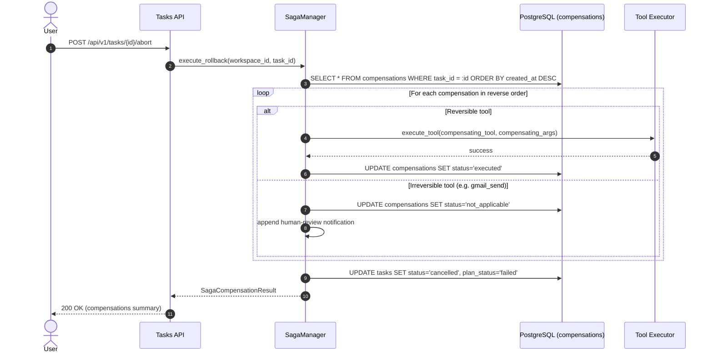

# Saga and Compensation Architecture (Phase 06)

## 1. Overview and Rationale

In distributed agent workflows, side effects on external services (such as sending messages, creating branches, or writing pages in external systems) cannot be rolled back via standard ACID database transactions. As specified in [`MAYA_AI_FINAL_PLAN.md`](../../MAYA_AI_FINAL_PLAN.md) §10.3 and Decision D6, MAYA AI utilizes the **Saga Pattern** with compensating actions.

When an agent executes an action that produces external side effects, it registers a corresponding compensating action in the `compensations` table within the current tenant database transaction. If the task is subsequently cancelled or fails validation, the `SagaManager` executes registered compensations in reverse topological/chronological order.

## 2. Reversible vs Irreversible Actions

External actions fall into two categories:

| Forward Action              | Reversible? | Compensating Tool       | Compensation Tier   | Behavior on Rollback                                             |
| :-------------------------- | :---------- | :---------------------- | :------------------ | :--------------------------------------------------------------- |
| `github_create_branch`      | Yes         | `github_delete_branch`  | `CONTROLLED_WRITE`  | Automatically deleted via compensating tool                      |
| `notion_create_page`        | Yes         | `notion_archive_page`   | `CONTROLLED_WRITE`  | Page is archived via compensating tool                           |
| `slack_create_channel`      | Yes         | `slack_archive_channel` | `CONTROLLED_WRITE`  | Channel is archived                                              |
| `gmail_send` / `email_send` | **No**      | None (`NULL`)           | `APPROVAL_REQUIRED` | Marked `not_applicable`, notification generated for human review |
| `stripe_charge`             | **No**      | None (`NULL`)           | `RESTRICTED`        | Marked `not_applicable`, human review required for refund        |

### Irreversible Handling

Irreversible actions are explicitly flagged (`IRREVERSIBLE_TOOLS`). When the rollback sequence encounters an irreversible action, it does **not** fail the saga; instead, it marks the compensation record as `not_applicable` and emits a human-review notification.

## 3. Data Model

The `compensations` table is secured via forced Row-Level Security:

```sql
CREATE TABLE compensations (
  id UUID PRIMARY KEY DEFAULT gen_random_uuid(),
  workspace_id UUID NOT NULL REFERENCES workspaces(id) ON DELETE CASCADE,
  task_id UUID NOT NULL,
  subtask_id UUID,
  forward_tool VARCHAR(150) NOT NULL,
  forward_ref JSONB NOT NULL,
  compensating_tool VARCHAR(150),
  compensating_args JSONB,
  permission_level VARCHAR(30) NOT NULL,
  status VARCHAR(30) NOT NULL DEFAULT 'registered'
    CHECK (status IN ('registered','pending_approval','executed','failed','not_applicable')),
  created_at TIMESTAMPTZ NOT NULL DEFAULT now(),
  CONSTRAINT compensations_task_fk FOREIGN KEY (workspace_id, task_id)
    REFERENCES tasks (workspace_id, id) ON DELETE CASCADE,
  CONSTRAINT compensations_subtask_fk FOREIGN KEY (workspace_id, subtask_id)
    REFERENCES subtasks (workspace_id, id) ON DELETE SET NULL (subtask_id)
);
```

## 4. Execution Sequence


