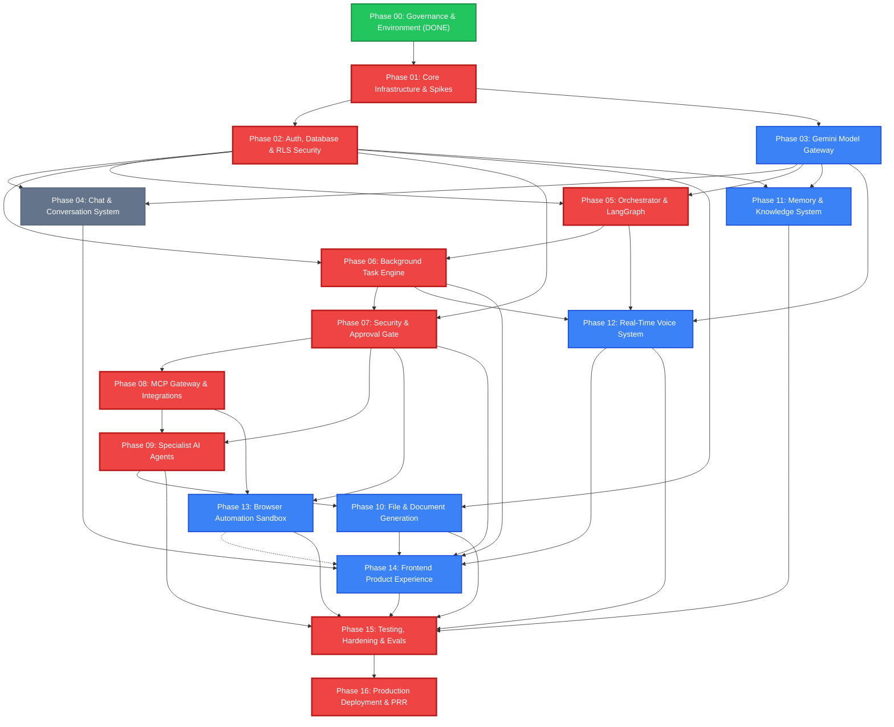

# MAYA AI — Implementation Dependencies and Critical Path

## 1. Complete Phase Dependency Matrix

The table below defines the strict upstream prerequisites and direct downstream unlock targets for every implementation phase. No phase may transition to `IN_PROGRESS` until all its direct upstream dependencies have met their Phase Exit Gate criteria.

These numbered implementation phases are detailed work packages; they are not the P1–P8 milestone numbers in `MAYA_AI_FINAL_PLAN.md` §19. Master-plan P1 spans implementation Phases 01–04 and cannot be considered complete after Phase 01 alone. Its 22-week calendar is unvalidated; do not use inherited target weeks as a committed schedule.

| Phase ID     | Phase Title                            | Direct Upstream Prerequisites                    | Direct Downstream Unlocks                        | Can Run in Parallel With               |
| :----------- | :------------------------------------- | :----------------------------------------------- | :----------------------------------------------- | :------------------------------------- |
| **Phase 00** | Project Governance & Dev Environment   | None (Root Initialization)                       | Phase 01                                         | —                                      |
| **Phase 01** | Core Infrastructure & Foundation       | Phase 00                                         | Phase 02, Phase 03                               | —                                      |
| **Phase 02** | Auth, Workspaces & DB Security         | Phase 01                                         | Phase 04, Phase 05, Phase 06, Phase 07, Phase 11 | Phase 03                               |
| **Phase 03** | Gemini Model Gateway                   | Phase 01                                         | Phase 04, Phase 05, Phase 11, Phase 12           | Phase 02                               |
| **Phase 04** | Chat & Conversation System             | Phase 02, Phase 03                               | Phase 14                                         | Phase 05, Phase 06                     |
| **Phase 05** | Orchestrator & LangGraph Framework     | Phase 02, Phase 03                               | Phase 06, Phase 12                               | Phase 04                               |
| **Phase 06** | Background Task Execution Engine       | Phase 02, Phase 05                               | Phase 07, Phase 12, Phase 14                     | Phase 04                               |
| **Phase 07** | Security, Permissions & Human Approval | Phase 02, Phase 06                               | Phase 08, Phase 09, Phase 13, Phase 14           | —                                      |
| **Phase 08** | MCP Gateway & Integrations             | Phase 07                                         | Phase 09, Phase 13                               | Phase 10, Phase 11                     |
| **Phase 09** | Specialist AI Agents                   | Phase 07, Phase 08                               | Phase 10, Phase 15                               | Phase 11, Phase 12                     |
| **Phase 10** | File Processing & Document Generation  | Phase 02, Phase 09                               | Phase 14, Phase 15                               | Phase 11, Phase 12, Phase 13           |
| **Phase 11** | Memory & Knowledge System              | Phase 02, Phase 03                               | Phase 14, Phase 15                               | Phase 08, Phase 09, Phase 10, Phase 12 |
| **Phase 12** | Real-Time Voice System                 | Phase 03, Phase 05, Phase 06                     | Phase 14, Phase 15                               | Phase 08, Phase 09, Phase 10, Phase 11 |
| **Phase 13** | Browser & Computer Automation          | Phase 07, Phase 08                               | Phase 14, Phase 15                               | Phase 09, Phase 10, Phase 11, Phase 12 |
| **Phase 14** | Frontend Product Experience            | Phase 04, Phase 06, Phase 07, Phase 10, Phase 12 | Phase 15                                         | Phase 13, Phase 11                     |
| **Phase 15** | Testing, Hardening & Evaluation        | All preceding: Phases 01–14                      | Phase 16                                         | —                                      |
| **Phase 16** | Production Deployment & Operations     | Phase 15                                         | Operations / Launch                              | —                                      |

Master-plan P1 is gated on completion of detailed Phases 01, 02, 03, and 04. Phase 02 and Phase 03 may proceed in parallel after Phase 01; Phase 04 requires both. The application schema and RLS work belongs to Phase 02, not the infrastructure-only Phase 01.

---

## 2. Mermaid Dependency Graph



---

## 3. Critical Path Analysis

The critical path determines the minimum calendar duration required to complete MAYA AI to production launch readiness. It consists of the strictly sequential backbone where each phase requires the verifiable output of its predecessor:

```
Phase 00 (Governance - 3 days, Done)
   └──► Phase 01 (Foundation & Spikes - 15 days)
           └──► Phase 02 (Auth, DB & RLS Security - 10 days)
                   └──► Phase 05 (Orchestrator Framework - 12 days)
                           └──► Phase 06 (Task Execution Engine - 12 days)
                                   └──► Phase 07 (Security & Approvals Gate - 10 days)
                                           └──► Phase 08 (MCP Gateway - 15 days)
                                                   └──► Phase 09 (Specialist Agents - 15 days)
                                                           └──► Phase 15 (Testing & Hardening - 15 days)
                                                                   └──► Phase 16 (Production Deployment - 15 days)
```

- **Critical Path Total Duration:** Approximately 109 business days (~22 calendar weeks).
- **Critical Path Bottlenecks:**
  - **Phase 02 (RLS & Database):** Unblocks all subsequent data models and task checkpointing.
  - **Phase 07 (Approval Gate):** Hard architectural prerequisite for Phase 08; no write-capable MCP tools may be enabled until the cryptographic approval gate is tested and active.
  - **Phase 08 (MCP Gateway):** Hard prerequisite for the Coding, Research, and Email specialist agents in Phase 09.

---

## 4. Parallel Opportunities and Resource Allocation

Once the critical path advances through Phase 01 and Phase 07, substantial parallel tracks open:

### Opportunity 1: Model Gateway and Chat Track (Weeks 3–6)

- While the backend team implements the database schema and RLS policies in **Phase 02**, an AI systems engineer can concurrently implement the `ModelGateway` in **Phase 03**.
- Once Phase 02 and Phase 03 are complete, conversational chat (Phase 04) can be developed alongside the LangGraph Orchestrator (Phase 05).

### Opportunity 2: Specialized Capabilities Tracks (Weeks 14–19)

- Following the completion of the MCP Gateway (Phase 08) and Specialist Agents (Phase 09), work splits into four independent tracks:
  - **Track A (Document Automation):** Phase 10 builds XLSX, DOCX, PPTX, and PDF generators and verifiers.
  - **Track B (Memory & Knowledge):** Phase 11 implements pgvector hybrid search, PII scrubber, and decay.
  - **Track C (Voice Subsystem):** Phase 12 builds WebAudio worklet capture, Silero VAD, and Gemini Live WebSocket bridge.
  - **Track D (Browser Sandbox):** Phase 13 provisions the containerized Playwright sandbox and anti-SSRF egress proxy.

### Opportunity 3: Frontend Surface Construction (Weeks 17–19)

- Phase 14 develops against stable OpenAPI specs and WebSocket protocols defined in earlier phases, wiring the Ambient Workspace, Deliverable Canvas, and Approval Center before comprehensive testing in Phase 15.
