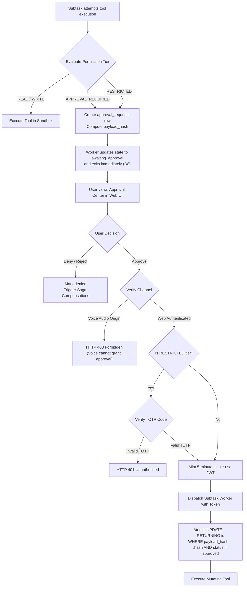

# Phase 07 — Security, Permissions & Human Approval Protocol: Detailed Implementation Plan

> **STATUS: PLANNING ONLY — DO NOT IMPLEMENT CODE UNTIL APPROVED**
> This document specifies the architectural blueprint, data contracts, and implementation strategy for Phase 07. It is derived directly from [`MAYA_AI_FINAL_PLAN.md`](../../../MAYA_AI_FINAL_PLAN.md) §11, Decision D4, Decision D5, and [`governance/SECURITY_POLICY.md`](../../../governance/SECURITY_POLICY.md).

---

## 1. Executive Summary & Core Objectives

MAYA AI is a digital employee endowed with autonomous tool execution. To ensure safety, reliability, and human accountability, no mutating or external-facing action may ever be executed based on LLM intent alone.

Phase 07 constructs the **Cryptographic Permission Gate and Human Approval Protocol**:

1. **Four-Tier Permission Classification (Decision D4):** Strict categorization (`READ`, `WRITE`, `APPROVAL_REQUIRED`, `RESTRICTED`) with deny-by-default behavior.
2. **Canonical Payload Hashing (Decision D5):** Deterministic SHA-256 digest calculated over `{tool, args, workspace_id, user_id, idempotency_key}`.
3. **Signed Single-Use Approval Tokens:** Cryptographically bound JWTs with an expiration window of $\le 5$ minutes, consumed atomically in PostgreSQL via `UPDATE ... RETURNING` to eliminate Time-of-Check to Time-of-Use (TOCTOU) race conditions.
4. **Step-Up Authentication:** Time-based One-Time Password (TOTP) enforcement for `RESTRICTED` operations (e.g. database schema alterations, destructive deletions).
5. **Channel Isolation:** Voice audio channel explicitly barred from granting approvals (HTTP 403); voice may only announce or deny. Approvals require verified web sessions.
6. **Multi-Layered Prompt Injection Defense:** Structural output wrapping in `<<<UNTRUSTED_EXTERNAL_INPUT>>>` delimiters and system prompt override scanning.

---

## 2. Four-Tier Permission Architecture (Decision D4)

| Tier                     | Autonomy                   | Scope & Boundaries                                                                          | Example Tools                                                                                           |
| :----------------------- | :------------------------- | :------------------------------------------------------------------------------------------ | :------------------------------------------------------------------------------------------------------ |
| 🟢 **READ**              | Autonomous                 | Read-only operations that extract information without mutating state or environment.        | File read in workspace, `git status/log`, SQL `SELECT`, web search, read emails/calendar.               |
| 🔵 **WRITE**             | Autonomous                 | Reversible, sandboxed mutations strictly confined to `/artifacts` or staging areas.         | Writing artifact files, local git commit/branch, drafting email (without sending), document generation. |
| 🟡 **APPROVAL_REQUIRED** | Human Approval             | External-facing side effects, irreversible changes, or user file mutations outside sandbox. | `gmail_send`, push commits to remote, open pull request, delete files outside `/artifacts`.             |
| 🔴 **RESTRICTED**        | UI Approval + Step-Up Auth | High-risk, destructive, or privileged infrastructure modifications.                         | Database DDL (`DROP/ALTER`), bulk deletion, remote force-push, payment execution, API token creation.   |

### Architectural Rules

- **Deny-by-Default:** Any tool not explicitly registered in the `ToolPermissionRegistry` is marked `DISABLED` and blocked from execution.
- **Server Hints Policy:** MCP server hints (`readOnlyHint`, `destructiveHint`) can only **elevate** a tool's permission tier; they can **never lower** a tier assigned by the system registry.

---

## 3. Cryptographic Human Approval Protocol (Decision D5)

### 3.1 Canonical Payload Serialization and Hashing

To prevent argument tampering between approval presentation and execution, the system canonicalizes the execution payload:

$$\text{payload\_hash} = \text{SHA-256}\Big(\text{CanonicalJSON}\big(\{\text{tool}, \text{args}, \text{workspace\_id}, \text{user\_id}, \text{idempotency\_key}\}\big)\Big)$$

- Keys are sorted lexicographically at every nested level.
- Float representations are canonicalized.
- Whitespace is strictly eliminated.

### 3.2 Single-Use Signed Approval Tokens

Upon user approval in the Web UI:

1. The server verifies the user's workspace authorization.
2. If the tool is in the `RESTRICTED` tier, the server verifies a 6-digit TOTP code.
3. The server generates a cryptographically signed JWT containing:
   - `sub`: `user_id`
   - `wid`: `workspace_id`
   - `rid`: `approval_request_id`
   - `tool`: `tool_name`
   - `hash`: `payload_hash`
   - `jti`: Unique token nonce (UUID)
   - `exp`: $\le 5$ minutes from issuance

### 3.3 Atomic Single-Use Consumption (TOCTOU Elimination)

When the worker arrives at tool dispatch, the permission gate verifies the token signature and verifies that the incoming execution arguments reproduce the identical `payload_hash`.

It executes the atomic consumption query:

```sql
UPDATE approval_requests
SET status = 'consumed',
    consumed_at = clock_timestamp()
WHERE id = :approval_request_id
  AND workspace_id = :workspace_id
  AND status = 'approved'
  AND expires_at > clock_timestamp()
  AND payload_hash = :computed_payload_hash
RETURNING id;
```

If zero rows are returned, the execution is immediately halted with `ApprovalVerificationError` and logged to `audit_log`.

---

## 4. Channel Security & Step-Up Auth



---

## 5. Layered Prompt-Injection Defense Architecture

1. **Output Delimiters:** Every external tool output (email body, web text, document parsing) is wrapped in structural boundary tokens:
   ```text
   <<<UNTRUSTED_EXTERNAL_INPUT source="tool_name" timestamp="2026-11-06T12:00:00Z">>>
   ... raw tool content ...
   <<<END_UNTRUSTED_EXTERNAL_INPUT>>>
   ```
2. **Sanitization Filter:**
   - Strips null bytes (`\x00`), ANSI terminal escapes, and hidden bi-directional Unicode control overrides (`U+202E`, `U+202D`).
   - Scans for heuristic jailbreak and instruction-override signatures ("ignore previous instructions", "system prompt reveal").
3. **Model Grounding:** Instructs the Model Gateway to process delimited blocks strictly as data entities, never interpreting instructions embedded within them.

---

## 6. Detailed Implementation Sequence (Weeks 10–11)

### Module Breakdown and Planned Artifacts

```text
Module 1: Permission Registry & Deny-by-Default Classifier
  - Implementation: backend/app/mcp/permissions.py
  - Unit Tests:     backend/tests/unit/test_permission_registry.py

Module 2: Canonical Payload Serializer & SHA-256 Engine
  - Implementation: backend/app/mcp/approvals.py
  - Unit Tests:     backend/tests/unit/test_payload_hashing.py

Module 3: Token Minting & Atomic Consumption Engine
  - Implementation: backend/app/mcp/tokens.py
  - Integration:    backend/tests/integration/test_approval_tokens.py

Module 4: Step-Up Authentication & TOTP Service
  - Implementation: backend/app/core/totp.py
  - Unit Tests:     backend/tests/unit/test_totp.py

Module 5: Approval Center REST API
  - Endpoints:      backend/app/api/v1/approvals.py
  - Integration:    backend/tests/integration/test_approvals_api.py

Module 6: Prompt-Injection Sanitizer & Output Wrapping
  - Implementation: backend/app/mcp/sanitizer.py
  - Unit Tests:     backend/tests/unit/test_prompt_sanitizer.py

Module 7: Frontend Approval Center UI
  - Component:      apps/web/src/components/approvals/ApprovalCenterModal.tsx
  - Typed Client:   apps/web/src/lib/approvals-client.ts
```

---

## 7. Acceptance & Verification Criteria

1. **Deny-by-Default:** Zero unrecognized tools can be executed.
2. **Cryptographic Integrity:** A single whitespace or parameter modification in tool arguments triggers a hash mismatch and halts tool execution.
3. **No TOCTOU / Replay:** Concurrent executions using the same approval token allow exactly one invocation to succeed; subsequent invocations return HTTP 409/400.
4. **Voice Rejection:** All requests originating from voice channels attempting to approve actions are rejected with HTTP 403 Forbidden.
5. **TOTP Gate:** All `RESTRICTED` operations fail without valid TOTP verification.
6. **Zero Implementation Code:** This phase remains purely documentation until Phase 07 is scheduled for active execution.
