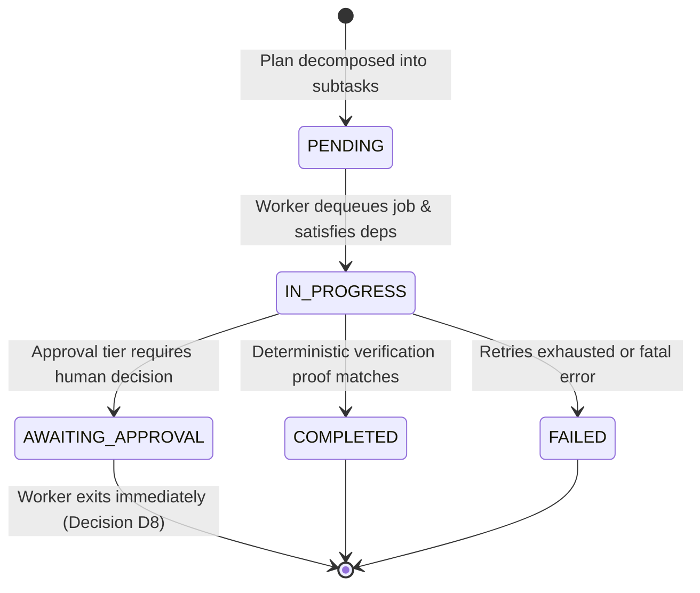

# Worker Architecture and Execution Rules (Phase 06)

## 1. Overview and Core Principles

The Background Task Execution Engine runs asynchronous subtask jobs dispatched by the Orchestrator, executing agent logic within bounded timeouts and maintaining zero idle-connection blocking.

The architecture is governed by **Decision D8** from [`MAYA_AI_FINAL_PLAN.md`](../../MAYA_AI_FINAL_PLAN.md) §10.4:

1. **Short Jobs:** Exactly one subtask per queued job message. Complex workflows are decomposed into DAGs; subtasks are enqueued individually.
2. **Never Block on Humans:** Workers never sleep or block waiting for human approval. When a subtask hits an approval requirement (`requires_approval=True`), the worker updates state to `awaiting_approval`, writes outbox events, checkpoints the state in PostgreSQL, and **exits immediately**.
3. **Bounded Timeouts:** Subtask execution is strictly bounded (default 300 seconds). Runaway loops or hung external tools trigger `TimeoutError` and increment retries.
4. **Idempotency Gate:** All mutating tasks carry `(workspace_id, idempotency_key)` to guarantee at-most-once execution even in the face of network retries or process restarts.
5. **Transactional Outbox:** Task and subtask state transitions write outbox events to `task_outbox_events` in the same PostgreSQL transaction. A dedicated dispatcher relays pending events to Redis Pub/Sub channels (`maya:events:{workspace_id}`).

---

## 2. Worker Lifecycle State Machine

---

## 3. Crash Recovery and Resilience

- **Worker Process Death:** If a worker process crashes mid-execution, PostgreSQL checkpoints and transactional outbox ensure uncommitted side effects are discarded or resumed upon restart.
- **Redis Outage:** If Redis Pub/Sub is unreachable, events remain with `status = 'pending'` in `task_outbox_events`. When Redis reconnects, the `OutboxDispatcher` picks up all pending events via `SELECT ... FOR UPDATE SKIP LOCKED` with zero message loss.
